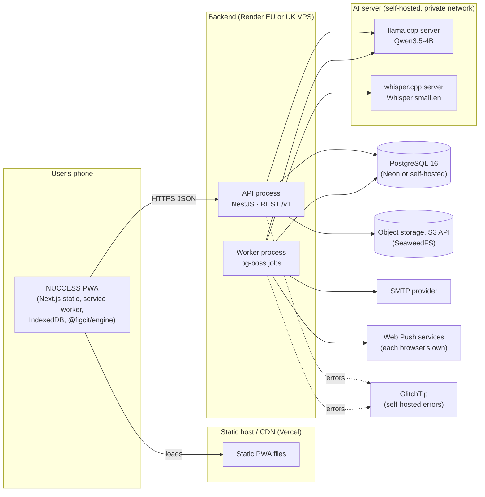
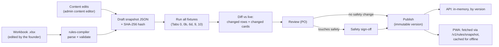
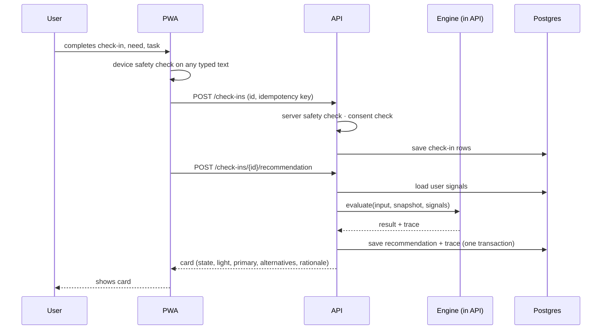

# NUCCESS backend: system design

How the backend (`figcit-backend`) is built: what it owns, its modules, the libraries and services each one uses, the data model, the API, and how it runs.

The frontend design is in the PWA repo: `figcit-pwa/docs/SYSTEM_DESIGN.md`.

**Built against:** Rules Engine v3.3 (the authority for behaviour), PRD/FRD v3.1, Activity Tables v2.1, Privacy Notice v0.1, all in `docs/specs/`. Open product decisions are in `docs/CONFLICTS.md` (D-xx). Where a decision is still open, this design uses that item's recommendation and says so.

---

## 1. What lives where

The PWA is meant to feel like a native app, so a lot happens on the device. The backend owns anything that must be trusted, kept, shared between devices, kept secret, or done when the app is closed.

| Concern | Device (PWA) | Backend |
| --- | --- | --- |
| Screens, navigation, animations, comfort settings | All | Stores the user's settings so they follow them to a new device |
| Check-in flow (state, feelings, sensations, context, need, task) | Collects it, keeps a draft, works offline | Validates and stores it |
| Recommendation engine | Runs the same engine for **Browse mode** and **offline** use | Runs it for every signed-in check-in. **Its result is the one that counts** and is logged |
| Engine rules and content | Caches the latest published snapshot | Owns versions: draft → review → safety sign-off → publish |
| Safety check on typed text | Runs first, on the device, so Help opens instantly, even offline | Runs again on every text it receives and logs a safety event |
| Help/SOS screen and crisis numbers | Fully on the device; works offline and without an account | Supplies the approved routes and copy in the snapshot |
| Pathway sessions (Breathe timer, sounds, focus timer, practice timer) | Run entirely on the device | Receives the session record and outcome |
| Dumps, tasks, drafts, reflections, practices, contacts | Local copy for speed and offline use | Stored copy (free text encrypted), synced between devices |
| AI features (sort a dump, break down a task, simplify, read "in your own words") | Shows results, lets the user edit, falls back to manual | Calls the AI provider; holds the keys; validates output |
| Voice to text | Records audio | Transcribes it, then deletes the audio |
| Reminders and push notifications | Asks permission, shows them | Schedules and sends them, enforcing quiet hours and "In worship" |
| Accounts, sign-in, consent | Sign-in screens; keeps the session | Identity, sessions, consent ledger, age rule, lockout |
| Plans and entitlement | Shows the plans screen | Decides what each user's plan unlocks |
| Progress and reports | Draws charts | Calculates them; creates share links |
| Admin console | Screens under `/admin` in the PWA | Role-checked admin API, audit log |
| Institution dashboard (later) | Screens | Aggregates with the anonymity floor |

**Why not keep more on the device**
- Check-ins are health data. Users switch phones and clear browsers, so the record has to live somewhere safe and backed up.
- Push reminders must be sent while the app is closed. Only a server can do that.
- AI and speech providers need secret keys, which can't ship to a browser.
- Every recommendation must be stored with its rule version and inputs (FR-M04-08, NFR-07). The server's run is the auditable one.
- Rules change without an app release, and safety changes need sign-off. Publishing has to be controlled centrally.

---

## 2. Architecture

A **modular monolith**: one NestJS application with clear modules, one Postgres database, and a worker process (same code, different entry point) for scheduled jobs. Two developers can run it, and modules can be split out later if needed.



**Principles**
1. **The engine is pure.** `@figcit/engine` is a TypeScript package with no I/O, no clock and no AI. The same inputs and snapshot always give the same card. Both the API and the PWA use it.
2. **Safety never depends on AI, the network or payment.** The safety check is deterministic phrase rules; Help/SOS is static.
3. **AI only helps with words.** It never decides the light, the pathway or a safety route, and every AI feature has a manual fallback (NFR-03).
4. **No cloud lock-in; health data stays on our servers.** AI and speech run on our own server with open-source models, so no third-party AI company sees user text or audio. Everything else uses an open standard (PostgreSQL, the S3 storage API, SMTP, Web Push, OpenID Connect, Docker), so any UK/EU provider, or our own server, can replace any piece.
5. **Nothing personal in logs or analytics.** Events carry IDs and codes, never free text (NFR-14).

---

## 3. Repository layout

A pnpm workspace, so the engine can be versioned and published on its own.

```
figcit-backend/
  apps/
    api/                    NestJS app (API + worker entry points)
      src/
        main.ts             starts the HTTP API
        worker.ts           starts the job worker (same modules, no HTTP)
        modules/            one folder per module (section 4)
        common/             config, crypto, db, errors, guards, openapi (no module logic)
        platform/           metrics and other cross-cutting infrastructure
      prisma/
        schema/             multi-file schema: _shared.prisma + one <module>.prisma each
        migrations/
      test/                 e2e tests (Testcontainers Postgres)
  packages/
    engine/                 @figcit/engine — pure decision engine (section 5)
      src/
      fixtures/             generated from the workbook scenario tabs
    rules-compiler/         reads the workbook .xlsx → snapshot JSON + fixtures
  docs/
    specs/                  source documents
    CONFLICTS.md
    SYSTEM_DESIGN.md
  openapi/                  generated openapi.json (never hand-edited)
  docker/                   compose.yaml for the local stack, api.Dockerfile
  scripts/                  repo checks used by CI
  .github/workflows/        CI and deploy
```

`@figcit/engine` is published to **GitHub Packages** (private npm) on each tagged release. The PWA installs it like any npm package.

---

## 4. Modules

Each module is a NestJS module with its own controller(s), service(s) and Prisma access. Modules talk through services and in-process events (`@nestjs/event-emitter`), never through each other's tables.

### 4.1 Platform modules

| Module | What it does | Built with |
| --- | --- | --- |
| **AuthModule** (M01, M19-02) | Magic-link sign-in, email + password, Google sign-in, sessions and refresh tokens, staff MFA, lockout after failed attempts, password reset, "sign out of all devices", sign-in log | `jose` (JWT), `argon2` (password hashing, argon2id), `openid-client` (Google OIDC), `otplib` (staff TOTP MFA). Later: `@simplewebauthn/server` (passkeys), institution SAML/OIDC SSO |
| **UsersModule** (M01, M16) | Account, nickname, age confirmation (D-02), comfort preferences (text size, theme, motion, sound, haptics, font, language), Browse-to-account upgrade, account deletion and data export | Prisma; export/delete run as worker jobs |
| **ConsentModule** (M16, NFR-05) | Append-only consent ledger per purpose (wellbeing data, personalisation, analytics, research, institution sharing), each tied to a notice version. Guards check consent before processing | Prisma, a `@RequiresConsent()` guard |
| **AuditModule** (NFR-10) | Append-only audit log of sensitive reads, shares, config changes and staff actions | Prisma; inserts only, no update/delete permission for the app's database role |
| **RulesModule** (M17, M04) | Rule-set versions: upload workbook → compile → validate → run fixtures → diff → review → safety sign-off → publish. Serves the published snapshot (with ETag) to the PWA | `@figcit/rules-compiler`, `@figcit/engine`, Prisma |
| **ContentModule** (M17) | Versioned content: tool catalogue and tiers, tool scripts (Breathe steps, Ground prompts, Move routines), Reflect prompts, practice library, card wording, crisis routes and Help copy. Same draft → review → publish flow | Prisma; published content is bundled into the snapshot |
| **AiModule** (M19-05) | One gateway for every AI task, with an allow-list of prompts, input minimisation, output validation, a timeout and a fallback | Self-hosted open model (Qwen3.5-4B on llama.cpp) behind an OpenAI-compatible HTTP API, called with Node's built-in `fetch`; zod 4 schemas turned into JSON Schema (`z.toJSONSchema`). Any compatible server (vLLM, llama.cpp) can be swapped in (NFR-13). Details in 4.3 |
| **SpeechModule** | Voice to text for Dump, Express and check-in "own words". Audio upload → transcription → editable text → audio deleted | Self-hosted whisper.cpp server (Whisper small.en); ffmpeg for audio conversion; worker job. Details in 4.3.5 |
| **FilesModule** | Private file storage: voice notes the user chooses to keep, uploaded practice audio, data exports. Presigned URLs only; sensitive files encrypted by us before upload | `minio` JS client (Apache-2.0) speaking the standard S3 API, so storage can be self-hosted SeaweedFS or any S3-compatible provider |
| **NotificationsModule** (M16) | Web Push subscriptions, reminder scheduling, quiet hours, "In worship" pause, notification style, in-app inbox, email | `web-push` (VAPID; works for Chrome, Firefox, Edge and Safari/iOS 16.4+ installed PWAs), `nodemailer` over any SMTP provider, pg-boss jobs |
| **JobsModule** | Background jobs and schedules: reminders, re-check nudges, transcription, export/delete, sustained-state safety check, analytics roll-ups | `pg-boss` (job queue inside Postgres, so no Redis) |
| **EntitlementsModule** (M16, M19-07) | Plans, entitlements and tool tiers. Answers "can this user open this tool?" and feeds the engine's entitlement step | Prisma. Payment provider added when D-13/D-14 are decided (Stripe recommended) |
| **AnalyticsModule** (M19-04) | Receives product events (no free text), only with analytics consent; daily roll-ups for the admin dashboard | Prisma (events table) + SQL roll-ups by worker |
| **SyncModule** | One endpoint the PWA uses to push offline changes and pull updates since its last sync | Prisma; per-record idempotency by client-generated ID |
| **HealthModule** | Liveness/readiness checks for the host and uptime monitor | `@nestjs/terminus` |

### 4.2 Product modules

| Module | PRD | Screens (PRD) | What it does | Built with |
| --- | --- | --- | --- | --- |
| **CheckInModule** | M02, M03 | S06–S10 | Stores check-ins: energy, mood, cell, source (grid or "Not sure"), emotions with intensity and family, sensations, body map, context, sensitivity flags, custom tags, re-check link | Prisma; values validated against the pinned snapshot |
| **RecommendationModule** | M04 | S11–S13 | Needs and tasks for a check-in; runs the engine; stores every decision with inputs, patterns fired, gates applied, rule version and trace (decision log); handles Start / Try another / Not now / correct | `@figcit/engine`; AiModule for "in your own words" parsing (S91) and task driver suggestions (S92) |
| **SafetyModule** | M14 | S31–S32 | Server-side safety check on every free text received; safety events (source module only, no content); support plan and trusted contacts' consent; sustained-Red check (SF-2, D-19); crisis routes per region | Phrase rules from the snapshot; pg-boss daily job |
| **RegulateModule** | M05 | S14–S15 | Regulate session records (tool, length, completed, stopped early); tool availability by context is in the engine | Prisma |
| **DumpModule** | M06 | S16–S17 | Dumps and items (text, voice), buckets (Ideas, Notes, Worries, To-do), move to task / Express / Reflect, history | Prisma (encrypted text); AiModule `sortDump` (Advanced); SpeechModule |
| **ExpressModule** | M07 | S18–S19 | Drafts and versions; Simplify / Rewrite (free, with a daily allowance), Draft / Structure / Script (Advanced); communication cards; never sends | Prisma (encrypted); AiModule `simplify`, `rewrite`, `draft`, `structure`, `script` |
| **TasksModule** | M08 | S20–S22 | Tasks with type, timeline code, recurrence, "putting it off" flag, NUCRIPCE tags; steps; focus sessions (paused, done); state-aware ordering and "why now" from the engine | Prisma; AiModule `breakDownTask` with a template fallback; engine for ordering |
| **AdaptModule** | M09 | S23 | Stores the adaptations chosen and re-runs the engine with them | Prisma; RecommendationModule |
| **ConnectModule** | M10 | S24 | Trusted contacts (with per-contact consent), message templates; sending is handed to the phone's SMS/WhatsApp/email apps (D-20) | Prisma (contact details encrypted) |
| **ReflectModule** | M11 | S25–S26 | Reflection entries (3 prompts, takeaway, topic tag), My Patterns, rumination tracking per topic for gate RF-2, "save for later" | Prisma (encrypted); rumination counts feed the engine |
| **PracticesModule** | M12 | S27–S29 | The user's own rituals, prayers and recitations (text, audio, link), schedules (TR), "helps me when struggling" and "makes me worse" flags, practice sessions, "In worship" mode | Prisma (encrypted); FilesModule for own audio; NotificationsModule for reminders |
| **FeedbackModule** | M13 | S30 | Helpful / effort / re-check, Blue Recovery window, queued next step release, validated outcomes for personalisation | Prisma; engine for re-check rules (RC-1–RC-5) |
| **ProgressModule** | M15 | S33–S34 | Progress summaries (30 days free, full history Advanced), "did it help?", share links to a named professional with expiry and revoke | Prisma + SQL aggregates; share links are signed, expiring tokens |
| **AdminModule** | M17 | S37 | Staff-only API: rule and content review, decision log, safety events, aggregate analytics, roles and access | RBAC guard + MFA required; every call audited |
| **InstitutionModule** | M18 | S38–S39 | **Later.** Tenants, cohorts with an anonymity floor (D-16), opt-in user summaries (D-17), outreach | `tenant_id` columns and roles exist from day one |

### 4.3 AI: what kind, which model, and how each task works

NUCCESS uses two kinds of AI, both **open-source models that we run on our own server**, and only for language:

1. **A small open language model** for reading and rewording text: understanding "in your own words", tagging tasks, breaking tasks into steps, sorting dumps, and simplifying or drafting messages.
2. **An open speech-recognition model** for turning voice into text.

No user text or audio goes to a third-party AI company, and nothing is tied to a cloud provider. Everything that decides what the user is offered is **not AI**: the safety check, the state and light, the pathway, the gates, personalisation and pattern cards are all fixed rules (section 4.3.7).

#### 4.3.1 The language model

| Item | Choice |
| --- | --- |
| Model | **Qwen3.5-4B** (Alibaba Qwen team, February 2026). **Licence: Apache-2.0.** About 4.7 billion parameters. Strong reasoning and instruction-following for its size, 262K context (we use a few thousand). Run in **non-thinking (instruct) mode** for speed. |
| File | Quantised GGUF build, `Q4_K_M` (a few GB of RAM). Pinned by file hash in config. |
| Server | **llama.cpp `llama-server`** (licence: MIT). Runs on ordinary CPUs, no GPU needed. Exposes an OpenAI-compatible HTTP API, supports JSON-schema-constrained output, and keeps the fixed system prompt cached between calls. |
| Lighter fallback model | **Qwen3.5-2B** (Apache-2.0, about 2.3B parameters), if the 4B model is too slow on the chosen server for the classification tasks |
| **Equal candidate** | **Gemma 4 E4B** (Google DeepMind, Apache-2.0). About 4.5B "effective" parameters (8B in the file, including per-layer embeddings), 128K context, non-thinking mode, built for on-device use. It also takes **audio input** with built-in speech recognition, so one model might cover language **and** voice (4.3.5). Likely needs more RAM than Qwen3.5-4B. Tested head-to-head with Qwen3.5-4B on every task (4.3.8). |
| Other candidates to test | **Ministral 3 3B Instruct** (Mistral AI, Apache-2.0; European), **Granite 4.1 8B** (IBM, Apache-2.0; better quality, needs more compute). |
| Later, with more users | The same model (or Qwen3.5-9B, Apache-2.0) on a GPU server with **vLLM** (licence: Apache-2.0), which speaks the same API. Only the server URL in config changes. |
| Where it runs | Our AI server (section 11), in the same UK/EU location as the rest of the system |

**Why this model:** Apache-2.0 allows commercial use with no usage restrictions. At around 4B parameters it fits on a CPU server and is the strongest size class that still answers short tasks in seconds. Qwen3.5 is also what the 2026 small-model comparisons most often rank first at this size. It's a text-and-image model; we only use text.

**To confirm in week 1:** Qwen3.5 uses a newer hybrid architecture. Ready-made llama.cpp (GGUF) builds are published, but we'll confirm it runs correctly on the pinned llama.cpp version, measure speed on the real server, and switch to Ministral 3 3B if either fails.

#### 4.3.2 Per task

| Task | Kind of AI task | Output form | Model | Sampling | Max output tokens | Timeout | Fallback |
| --- | --- | --- | --- | --- | --- | --- | --- |
| `parseNeed` | Classification + extraction | JSON (schema-constrained) | Qwen3.5-4B (or 2B) | temperature 0.2 | 200 | 8 s | Show the need list (S11) |
| `suggestDrivers` | Multi-label classification | JSON | Qwen3.5-4B (or 2B) | 0.2 | 100 | 8 s | Keyword rules from Tab 6 |
| `breakDownTask` | Constrained generation | JSON (list of steps) | Qwen3.5-4B | 0.4 | 300 | 20 s | Step templates (shown at once, replaced when the AI steps arrive) |
| `sortDump` (Advanced) | Per-item classification | JSON | Qwen3.5-4B (or 2B) | 0.2 | 400 | 20 s, runs in the background | Manual sorting |
| `simplify`, `rewrite` | Text transformation | Plain text, **streamed** to the screen | Qwen3.5-4B | Model card's instruct settings (0.7 / top-p 0.8 / top-k 20) | 600 | 45 s | Keep the original text |
| `draft`, `structure`, `script` (Advanced) | Short generation | `draft`: streamed text. `structure`, `script`: JSON | Qwen3.5-4B | 0.7 | 800 | 45 s | Fill-in templates |
| `rewordReason` | Paraphrase | — | — | — | — | — | **Off.** Card rationales use approved templates only. |

The timeouts are generous because the model runs on a CPU. They'll be tightened after the week-1 speed test. Long outputs are streamed so the user sees words appear instead of waiting.

#### 4.3.3 Each task in detail

**`parseNeed`**, "in your own words" (Figma S91)
- **Input:** the user's sentence (typed or transcribed, up to 500 characters) and the need codes with their labels from the snapshot.
- **Output (JSON schema):** `{ needs: NeedCode[] (1–2), heard: { label, kind: "feeling" | "setting" | "task" | "need" }[] (max 5), task: { title, type: "study" | "work" | "health" | "social" | "home_other" } | null, supportOnly: boolean }`. Need codes are an enum in the schema, so the model can only pick real codes.
- **Checks:** labels short (≤ 24 characters); no banned phrases.
- **The user stays in control:** results appear as "We heard" chips the user can remove. Nothing reaches the engine until they tap Continue.

**`suggestDrivers`**, task card (Figma S92)
- **Input:** task title and task type. Not the timeline: **Urgency always comes from the timeline code, never from AI** (Tab 5).
- **Output:** `{ drivers: ("novelty" | "challenge" | "routine" | "interest" | "passion" | "collaboration" | "exploration")[] (0–3), demandCharacteristics: Tab6Code[] }`.
- **Shown as** small indicators on the task card, never a form (PRD 1.5).

**`breakDownTask`**, Break it down (S19, S21)
- **Input:** task title, type, the **step cap** from the timeline code (Tab 4: T0 up to 3 steps, T1 3–5, …), and whether the light is Amber (smallest routine steps only).
- **Output:** `{ steps: { text (≤ 80 chars), minutes (1–30) }[] (maxItems = step cap), estimatedDemand: "low" | "moderate" | "heavy" }`. The step cap is written into the schema, so the model can't exceed it.
- **Checks:** each step a single action; no blame words ("finally", "should have").
- **Experience:** template steps for the task type appear immediately. The AI steps replace them when ready, unless the user has already started editing. The user can edit, reorder or delete any step (S127).

**`sortDump`** (Advanced), Dump review (S17)
- **Input:** the dump's items as `{ id, text }`.
- **Output:** `{ items: { id, bucket: "ideas" | "notes" | "worries" | "todo" }[] }`; we check every id appears exactly once.
- Runs as a background job after the dump is saved; suggestions show next time the review opens. Worries are never turned into tasks (Figma S103).

**`simplify` and `rewrite`**, Express (S19, Figma S115)
- **Input:** the user's text (up to 2,000 characters), level (`gentle` / `clear` / `shortest`), optional purpose ("reply to my tutor").
- **Output:** plain text, streamed.
- **"What we changed"** (Figma S22, S115) is worked out **by rules, not AI**: word count before and after, and which hedging or apology phrases from a fixed list were removed ("Removed 3 apologetic phrases · 84 → 22 words").
- **Checks after streaming:** output not longer than the input for `simplify`; no new names, dates or numbers that weren't in the input; banned-phrase check. If a check fails, the result is replaced with the original and a gentle note.
- **Free** with a daily allowance (configurable, default 10 a day). Never sends anything (FR-M07-02).

**`draft`, `structure`, `script`** (Advanced), Express (Figma S22, S114, S116)
- **`draft`:** the user's notes and purpose in; streamed text out.
- **`structure`:** JSON `{ sections: { role: "ask" | "why" | "offer" | "close" | "other", text }[] }` (Figma S114).
- **`script`:** JSON `{ lines: { cue: "you" | "if_asked_why" | "if_none_free" | "to_end" | "other", text }[] }` (Figma S116).
- Same checks as `simplify`.

#### 4.3.4 How every call is made

The backend talks to the model server over its OpenAI-compatible HTTP API with Node's built-in `fetch`. There is no vendor SDK, so llama.cpp, vLLM or any other compatible server can sit behind it.

```ts
const res = await fetch(`${config.ai.baseUrl}/v1/chat/completions`, {
  method: "POST",
  headers: { "content-type": "application/json", authorization: `Bearer ${config.ai.token}` },
  signal: AbortSignal.timeout(task.timeoutMs),
  body: JSON.stringify({
    model: task.model, // e.g. "qwen3.5-4b-q4_k_m"
    messages: [
      { role: "system", content: prompt.system }, // fixed per task, so the server caches it
      { role: "user", content: `<user_words>\n${cleanText}\n</user_words>` },
    ],
    response_format: { type: "json_schema", json_schema: { name: task.name, schema: z.toJSONSchema(task.schema) } },
    temperature: task.temperature,
    max_tokens: task.maxTokens,
    chat_template_kwargs: { enable_thinking: false }, // instruct mode
  }),
});
const parsed = task.schema.safeParse(JSON.parse((await res.json()).choices[0].message.content));
return parsed.success ? (task.check(parsed.data, input) ?? task.fallback(input)) : task.fallback(input);
```

- **Constrained output:** the JSON schema is turned into a grammar by the server, so the model can only produce valid JSON in that shape. zod then re-validates, and `check()` applies the business rules above.
- **Streaming tasks** use the same endpoint with `stream: true` and are passed to the PWA as server-sent events.
- **Before sending:** the server safety check runs first (risk text never reaches the model; it opens Help). Emails, phone numbers and URLs are stripped; text is capped at the task's limit. No user ID, name or account detail is included.
- **Prompt injection:** the user's words are wrapped in `<user_words>` tags, and every system prompt says the text inside is data to work on, never instructions.
- **Prompts are content:** each task's system prompt is a versioned content item (ContentModule), reviewed like other copy, with the banned-phrase list (no diagnosis, no reassurance, no blame).
- **No retries on interactive calls:** on failure or timeout the fallback shows at once.
- **Capacity:** `llama-server` runs a few requests in parallel (`--parallel`) and queues the rest. A per-user daily limit per task protects it. Browse users get a smaller limit per device token, and nothing is stored.
- **Security:** the model server listens only on the private network (or behind TLS with a token if it's on a separate host) and is never exposed to the internet.
- **Logging:** each call writes an `ai_calls` row (task, prompt version, model file hash, latency, tokens, outcome or fallback reason). **Never the text.**

#### 4.3.5 Speech to text

| Item | Choice |
| --- | --- |
| Model | **Whisper `small.en`** (OpenAI, open weights; licence Apache-2.0 on Hugging Face). English-only, good accuracy, fast enough on a CPU. |
| Server | **whisper.cpp `whisper-server`** (licence: MIT) on the AI server, with its voice-activity detection on, so silence isn't turned into invented text (a known Whisper weakness) |
| Audio conversion | **ffmpeg** converts what the browser records (WebM/Opus on Chrome, MP4/AAC on Safari) to 16 kHz WAV for Whisper |
| Flow | PWA records → uploads by presigned URL to our object storage → a worker job sends it to whisper-server → the text returns to the app, where the user can **edit it before it's used** → the audio is deleted |
| Limits | Up to 10 minutes per recording (Figma S102) |
| Candidate to replace Whisper | **Gemma 4 E4B** audio input (4.3.1). If it transcribes as accurately as Whisper small.en and invents no text on silence, the AI server runs one model instead of two. It's tested on the same recordings, and only adopted if llama.cpp's server (or vLLM) supports its audio input. |
| Later | **Whisper large-v3-turbo** (MIT, multilingual) on the GPU server for more accuracy and other languages. A live transcript while speaking (Figma S102), via whisper.cpp streaming. Possibly in-browser Whisper so voice never leaves the phone (D-12). |

#### 4.3.6 Voice for guided practices (later, content only)

**Kokoro-82M** (licence: Apache-2.0), a small text-to-speech model, run by the content team on their own machine to produce guided-practice audio once. A person reviews every file before it's published. It's never run per user.

#### 4.3.7 What is deliberately not AI

| Feature | What it uses | Why |
| --- | --- | --- |
| **Safety check** | Fixed phrase rules | It has to be predictable, clinically signed off, testable line by line, and work offline on the phone. A model could miss or flag differently from one day to the next. |
| **State, light, pathway, gates** | The engine's fixed rules | Same input, same result, always explainable (NFR-07) |
| **Personalisation** (re-ranking options) | Counting, not machine learning | Per user, state group and tool, count outcomes that were completed, rated helpful and followed by a no-worse re-check; use the counts to order options the rules already allowed. Never changes the light, gates or safety. |
| **My Patterns, "What we learned", progress sentences** | Counts and fixed sentence templates | No model reads reflections or check-ins to interpret them (PRD: no clinical interpretation; reflections are private) |
| **"What we changed"** in Express | Word counts and a phrase list | Cheap, exact, and can't misdescribe the change |

#### 4.3.8 Testing and choosing models

- Each task has an **eval set** of 50–100 synthetic examples written with the founder (for example 80 "own words" sentences with the right need codes; tasks with acceptable step lists).
- The same sets measure **speed and memory on the real server**. Qwen3.5-4B and Gemma 4 E4B are compared head-to-head on every task, with Qwen3.5-2B and Ministral 3 3B as lighter options. The results pick the model per task and set the final timeouts.
- **Speech test:** about 50 short recordings (different accents, quiet and noisy rooms, a few with long silences), scored by word error rate and by any invented text. Whisper small.en and Gemma 4 E4B both run on them.
- They run before any prompt or model change and nightly in CI.
- Pass bars before a task is switched on, for example: `parseNeed` correct top need ≥ 85%; `breakDownTask` 100% within the step cap; zero banned phrases; 95% of calls inside the timeout.

#### 4.3.9 Cost

No per-call fees. The cost is the AI server itself: a CPU server with about 8 cores and 16–32 GB RAM for the model and Whisper, at a fixed monthly price. When usage grows, add a GPU server running vLLM; no code changes.

---

## 5. The engine (`@figcit/engine`)

### 5.1 What it is

A pure TypeScript package:

```ts
evaluate(input: EngineInput, snapshot: RuleSnapshot, signals: UserSignals): EngineResult
```

- **`EngineInput`**: energy, mood (or "Not sure" answers), emotions with intensity, sensations and flags, context and sensitivity flags, need, optional task with timeline code, and any adaptations.
- **`UserSignals`**: plan entitlements, recent rejections, rumination counts per topic, user flags ("meditation makes me worse"), recovery window state, recent safety event. The API loads these; the engine never queries anything.
- **`EngineResult`**: state (name, icon, meaning), final light, primary action, up to 2 alternatives, queued step, rationale template and slots, safety outcome, and a trace (each stage, rules fired, gates applied, what was removed and why), plus engine and snapshot versions.

### 5.2 Stages (Workbook Tab 8, PRD 8.4)

| # | Stage | Source in the workbook |
| --- | --- | --- |
| 0 | Safety screen: risk phrases or risk options → Help/SOS, stop | Tab 7 pattern 28, Tab 10 SF-1 |
| 1 | State lookup → cell, name, icon, meaning, baseline band (Not sure → NS-1) | Tab 1 |
| 2 | Experience → families, peak intensity, flags (shutdown, overload, pain) | Tab 2 |
| 3 | Context → setting class (public, formal, observed, unfamiliar), sensitivity count, tool filters | Tab 3 |
| 4 | Band modifiers EX-1, CX-1, CAP-1, UP-0, DEM-0, E4M1 rule → final band and light | Tab 10 |
| 5 | Need → route; support-only skips 6–7 | Tab 6b |
| 6 | Demand: timeline code → urgency and step cap; NUCRIPCE tags; Routine-only in Amber; defer in Red | Tabs 4, 5, 6 |
| 7 | Pattern match, patterns 1–41 in priority order | Tab 7 |
| 8 | Gates RF-1–RF-5 and MD-1–MD-6, with fallbacks | Tab 6c |
| 9 | Context tool filter (discreet first in public, hide unrealistic tools) | Tab 3 |
| 10 | Entitlement filter: free primary always; one labelled Advanced alternative only in Green/Yellow/Blue | Tab 6d, ENT-1–ENT-3 |
| 11 | Personalisation re-ranks allowed options only (off until enough validated outcomes) | PRD FR-M13-04 |
| 12 | Card: one primary, up to two alternatives, rationale, queued step | Tab 8 step 10 |

Re-check and recovery (RC-1–RC-5) is a second function, `evaluateRecheck(previous, recheck, snapshot)`.

### 5.3 Rules as data vs rules as code

The workbook mixes tables with prose rules, so the split is:

| Data (in the snapshot, changeable without a release) | Code (in the engine, changed by a release) |
| --- | --- |
| 16 cells: names, icons, meanings, baseline bands, default lean | The stage order |
| Emotion options → families; sensation tags → flags | How modifiers combine (CAP-1, UP-0) |
| Context options, setting classes, tool filters | Pattern matching logic for patterns 1–41 |
| Timeline codes, urgency weights, step caps | Gate logic (RF, MD) and their fallbacks |
| NUCRIPCE keyword hints | Entitlement filter logic |
| Need list and routes | |
| Intensity thresholds, recovery window length, rumination counts, all numeric thresholds | |
| Tool catalogue, tiers, safety floor, public-safe and eyes-open flags | |
| Card wording, rationale templates, Help copy, crisis routes | |
| Safety phrase rules | |

Each pattern is a small typed function with an ID (`P05`) whose thresholds and wording come from the snapshot. A pattern's logic only changes with an engine release, which goes through the same fixture tests.

### 5.4 Snapshot pipeline



- **Validation** fails the draft if any cell is missing, a pathway has no free tool in some light or context (ENT-1), a safety-floor tool is marked Advanced (ENT-2), a timeline code lacks a step cap, or any fixture changes result without being marked as an intended change.
- **Publish** is immutable. Rollback means publishing an older version again.
- **Every stored recommendation** records `engine_version` and `snapshot_version`, so it can be replayed exactly.

### 5.5 Engine IP

The PWA needs the engine and the snapshot for Browse mode and offline use. A determined person could read both from the app bundle. The workbook README accepts that names are visible but wants the logic protected. Options (decision for the founder):

1. **Ship the full engine and snapshot** (simplest; Browse and offline work properly). Recommended for the MVP.
2. **Ship an offline subset**: the 16 cells, safety rules, crisis routes and one default card per cell. Browse mode then needs the server.

---

## 6. Data model

PostgreSQL 16 (Neon or self-hosted), accessed through Prisma. All IDs are UUIDv7, generated on the device for anything created offline (so syncing is idempotent). Every user-owned row has `user_id`, `created_at`, `updated_at` and `deleted_at` (soft delete until the hard-delete job runs). `tenant_id` is nullable from day one for institutions.

🔒 = encrypted at application level (section 9.3).

### 6.1 Identity and consent

| Table | Key fields |
| --- | --- |
| `users` | id, email (unique, nullable for staff-created test users), email_verified_at, password_hash (nullable), nickname, age_confirmed_at, age_band (`18_plus` / `16_17_institution`), locale, region (for crisis routes), status (active / suspended / deleted), role (`customer`, `admin`, `safety_reviewer`, `content_editor`, `institution_supporter`), tenant_id |
| `auth_identities` | user_id, provider (`google`, later `apple`, `saml`), provider_subject |
| `sessions` | id, user_id, refresh_token_hash, device_label, created_at, last_used_at, expires_at, revoked_at |
| `magic_links` | token_hash, email, expires_at (10 min), used_at |
| `mfa_factors` | user_id, type (`totp`), secret 🔒, confirmed_at |
| `sign_in_events` | user_id, method, device type, result, at |
| `preferences` | user_id, text_size, theme, high_contrast, reduce_motion, sound, haptics, dyslexic_font, low_stimulation, notification_style, quiet_hours_start/end, in_worship |
| `consents` | user_id, purpose, granted (bool), notice_version, at (append-only; latest row per purpose wins) |
| `audit_events` | actor_id, actor_role, action, target_type, target_id, reason, at (append-only) |

### 6.2 Rules and content

| Table | Key fields |
| --- | --- |
| `rule_snapshots` | version (e.g. `3.3.0+1`), hash, source_file_key, status (draft / in_review / safety_review / published / retired), json (JSONB), fixture_report (JSONB), created_by, reviewed_by, safety_signed_by, published_at |
| `content_items` | key (e.g. `tool.regulate.breathe.instructions`), locale, version, status, body (JSONB), touches_safety (bool), author, reviewer |
| `tools` | tool_id, pathway, tier (free / advanced), safety_floor, public_safe, eyes_open, active (configuration mirrored into the snapshot) |

### 6.3 Check-in and engine

| Table | Key fields |
| --- | --- |
| `check_ins` | id, user_id, energy (1–4), mood (1–4), cell_id, source (`grid` / `not_sure`), not_sure_answers, confirmed, is_recheck, recheck_of_id, snapshot_version, created_on_device_at, origin (`online` / `offline`) |
| `check_in_emotions` | check_in_id, emotion_code, family_code, intensity (0–10) |
| `check_in_sensations` | check_in_id, category, tag_code, intensity, body_regions |
| `check_in_contexts` | check_in_id, environment, people, time_available, support, sensitivity_flags[], custom_tag_ids[] |
| `custom_tags` | user_id, type, label 🔒 |
| `needs` | check_in_id, need_code, own_words 🔒, just_support |
| `tasks` | user_id, title 🔒, type, timeline_code, due_at, recurrence_rule, putting_off, nucripce_tags[], status, source (`demand`, `dump`, `manual`), snoozed_until |
| `task_steps` | task_id, position, text 🔒, done_at |
| `recommendations` | id, user_id, check_in_id, task_id, band, light, primary (JSONB), alternatives (JSONB), queued_step (JSONB), patterns[], gates[], rationale_template_id, trace (JSONB), engine_version, snapshot_version, origin (`server` / `device`) |
| `recommendation_actions` | recommendation_id, action (`start` / `try_another` / `not_now` / `correct` / `get_support`), detail, at |

### 6.4 Pathways and outcomes

| Table | Key fields |
| --- | --- |
| `pathway_sessions` | id, user_id, recommendation_id, pathway, tool_id, length_seconds, completed, stopped_early, started_at, ended_at |
| `feedback` | session_id, helpful (1–5), effort (1–5), recheck_check_in_id, recovery_started_at |
| `dumps` / `dump_items` | dump: user_id, source (text / voice). item: text 🔒, bucket, moved_to (task / draft / reflection) |
| `drafts` / `draft_versions` | purpose 🔒, mode (draft / simplify / structure / script / record), body 🔒, ai_used |
| `adaptations` | recommendation_id, kind (environment / scope / modality / pace / sequence / instructions / communication), detail |
| `trusted_contacts` | user_id, name 🔒, phone_or_email 🔒, relationship, contact_when (connect / sos) |
| `support_plans` | user_id, preferred_routes, prewritten_messages 🔒 |
| `reflections` | user_id, variant, answers 🔒, takeaway 🔒, topic_tag, saved, safety_flag |
| `practices` / `practice_sessions` | practice: type (ritual / prayer / recitation), name 🔒, content 🔒 or file_key, schedule, reminder_style, helps_when_struggling, makes_me_worse. session: length, completed, eyes_open, context_public |
| `reminders` | user_id, subject_type (task / practice / recheck / custom), subject_id, at or rrule, style |
| `push_subscriptions` | user_id, endpoint, keys 🔒, user_agent, created_at |
| `inbox_items` | user_id, kind, ref, read_at |
| `safety_events` | user_id (nullable), source_module, trigger (`button` / `phrase` / `option` / `sustained`), route_chosen, at (no text stored) |
| `shares` | user_id, recipient_label, scope (JSONB), token_hash, expires_at, revoked_at |
| `entitlements` | user_id, plan (`free` / …), source (`none` / `store` / `web` / `institution`), status, renews_at |
| `events` | name, user_id (pseudonymous hash), props (JSONB, codes only), at |
| `tenants` (later) | name, anonymity_floor, settings |

---

## 7. API

REST over HTTPS, JSON, versioned under `/v1`. The OpenAPI document is generated from the NestJS controllers (`@nestjs/swagger` with `nestjs-zod` schemas) and published on every build. The PWA generates its typed client from it.

**Conventions**
- Auth: `Authorization: Bearer <access token>` (15-minute JWT). Refresh through `/v1/auth/refresh` (section 9.1).
- Every create accepts a client-generated `id` (UUIDv7) and an `Idempotency-Key` header, so offline retries never duplicate.
- Errors follow RFC 9457 problem details with plain, non-blaming `title` text.
- Pagination by cursor (`?after=`).

**Endpoints by module (MVP)**

| Module | Endpoints |
| --- | --- |
| Auth | `POST /auth/magic-link`, `POST /auth/magic-link/verify`, `POST /auth/password/sign-in`, `POST /auth/password/forgot`, `POST /auth/password/reset`, `GET /auth/google/start`, `GET /auth/google/callback`, `POST /auth/refresh`, `POST /auth/sign-out`, `POST /auth/sign-out-all`, `POST /auth/mfa/verify` |
| Users | `GET /me`, `PATCH /me`, `PUT /me/preferences`, `POST /me/age-confirmation`, `POST /me/upgrade-from-browse` (imports device data), `POST /me/export`, `DELETE /me` |
| Consent | `GET /me/consents`, `POST /me/consents` |
| Rules | `GET /rules/snapshot` (ETag; public, no auth: it holds no user data) |
| Check-in | `POST /check-ins`, `GET /check-ins?after=` |
| Recommendation | `POST /check-ins/{id}/recommendation` (body: need, optional task), `POST /recommendations/{id}/actions`, `POST /recommendations/{id}/adapt`, `GET /recommendations/{id}/why` |
| Safety | `POST /safety/events`, `GET/PUT /me/support-plan`, `GET/POST/PATCH/DELETE /me/trusted-contacts` |
| Sessions & feedback | `POST /sessions`, `PATCH /sessions/{id}`, `POST /sessions/{id}/feedback` |
| Dump | `POST /dumps`, `GET /dumps`, `PATCH /dump-items/{id}`, `POST /dump-items/{id}/to-task` |
| Express | `POST /drafts`, `PATCH /drafts/{id}`, `POST /drafts/{id}/assist` (mode: simplify / rewrite / …) |
| Tasks | `GET/POST /tasks`, `PATCH/DELETE /tasks/{id}`, `POST /tasks/{id}/break-down`, `PUT /tasks/{id}/steps`, `GET /tasks/ordered` (capacity order with "why now") |
| Reflect | `POST /reflections`, `GET /reflections`, `GET /patterns` |
| Practices | `GET/POST/PATCH/DELETE /practices`, `POST /practice-sessions` |
| Speech | `POST /speech/uploads` (returns presigned URL), `POST /speech/transcriptions`, `GET /speech/transcriptions/{id}` |
| AI | `POST /ai/parse-need`, `POST /ai/suggest-drivers` (also anonymous with a Browse token, rate-limited, nothing stored) |
| Notifications | `POST /push/subscriptions`, `DELETE /push/subscriptions/{id}`, `GET/POST/PATCH/DELETE /reminders`, `GET /inbox`, `POST /inbox/{id}/read` |
| Progress | `GET /progress?range=`, `GET /progress/did-it-help`, `POST /shares`, `DELETE /shares/{id}`, `GET /shared/{token}` (recipient view) |
| Plans | `GET /plans`, `GET /me/entitlements` |
| Sync | `POST /sync/push` (batch of offline creates/updates), `GET /sync/pull?since=` |
| Analytics | `POST /events` (batch; dropped unless consent) |
| Admin | `GET /admin/snapshots`, `POST /admin/snapshots` (upload workbook), `POST /admin/snapshots/{v}/review`, `/safety-sign-off`, `/publish`; `GET/POST /admin/content`; `GET /admin/decisions` (decision log); `GET /admin/safety-events`; `GET /admin/metrics`; `GET/PATCH /admin/staff` |

### 7.1 Main sequence: check-in to card (signed in, online)



The PWA shows the state name the moment Energy × Mood is chosen, from its cached snapshot, without waiting for the server.

---

## 8. Offline sync

The PWA keeps an outbox in IndexedDB (see the PWA design). The backend's side:

- `POST /sync/push` takes a batch of operations `{ id, entity, op (create / update / delete), data, client_updated_at }`, applies each in its own transaction, and returns per-item results. Re-sent items with the same `id` are no-ops.
- **Conflicts**: append-only records (check-ins, sessions, feedback, safety events, reflections) can't conflict. Editable records (tasks, drafts, practices, contacts, preferences) use last-write-wins on `client_updated_at`, field by field for preferences.
- **Offline recommendations**: a check-in made offline arrives with the card the device engine showed (`origin = device`). The server stores that card as shown, then runs its own engine and stores the result as well. If they differ, the server's card is used for anything still pending (queued steps), and the difference is logged for engine QA. The user is not shown a second card unless they reopen the check-in.
- `GET /sync/pull?since=` returns records changed since the cursor, for a second device.

---

## 9. Security and privacy

### 9.1 Sessions and tokens
- **Access token**: JWT (EdDSA), 15 minutes, held in memory by the PWA.
- **Refresh token**: random 256-bit, stored hashed, rotated on every use, with reuse detection (a reused token revokes the whole session).
  - **Browser (PWA)**: sent as an `HttpOnly; Secure; SameSite=Lax` cookie scoped to the API domain. This works because `app.` and `api.` share the `figcit.co.uk` site.
  - **Capacitor later**: returned in the response body and kept in the device's secure storage. Same endpoint, chosen by a header.
- **Browse mode**: an anonymous device token (no user row) lets the PWA call the anonymous AI and snapshot endpoints with rate limits. Nothing is stored against it.
- **Staff**: TOTP MFA required for every admin role; admin sessions last 8 hours.
- **Lockout**: 5 failed password attempts → 15-minute lock and an email to the owner. Messages never reveal whether an email has an account.
- **Vercel preview deploys** use a separate staging API with bearer-only mode, since `*.vercel.app` isn't same-site.

### 9.2 Request protection
- `helmet` security headers; strict CORS allow-list (`app.figcit.co.uk`, staging, localhost).
- `@nestjs/throttler` rate limits per IP and per user; tighter on auth, AI and speech routes.
- Input validation with zod on every route; unknown fields rejected.
- File uploads only by presigned URL, with size and type limits.

### 9.3 Encryption
- TLS everywhere. The database and object storage encrypt their disks; on our own servers the disks are encrypted (LUKS).
- **Application-level encryption** (AES-256-GCM, envelope keys) for free text, contact details and stored files (🔒 in section 6). Each record's data key is encrypted with a **master key that never sits in the database**: on a VPS it is a root-only file deployed with **SOPS + age** (open source); on Render it is a secret environment variable. Keys carry a version ID so they can be rotated. **OpenBao** (open-source fork of Vault, MPL-2.0) can take over key handling later without changing the callers. Anyone with database access alone sees ciphertext, which matters because the build team works from outside the UK.
- Consequence: no database search over encrypted text. "Search across dumps" (Advanced) would decrypt per user in memory.

### 9.4 Data rights and retention
- Export: a worker job builds a JSON + readable PDF/HTML bundle, uploads it to object storage, emails a 24-hour link.
- Delete: soft delete at once (signed out everywhere), hard delete within 30 days, backups expire within 90 days (Privacy §7).
- Safety records: kept for the period set on legal advice (Privacy §7, still to decide).
- Audio: deleted as soon as transcription finishes unless the user chose to keep a voice note.

### 9.5 Logging
- Structured JSON logs with `pino` (`nestjs-pino`). Request bodies are never logged. Free text, emails and tokens are redacted.
- **GlitchTip** (open source, MIT, self-hosted) for errors. It accepts the standard Sentry SDKs, so the app uses `@sentry/nestjs` pointed at our own GlitchTip. Request bodies are stripped and user IDs hashed.

---

## 10. Notifications

- The PWA subscribes with the Push API (VAPID). The server stores the subscription.
- Reminder jobs are scheduled in pg-boss at the user's local time.
- **Before sending**, the worker checks: quiet hours, "In worship" / do-not-disturb, notification style, the per-category setting, capacity tuning (fewer nudges after Amber/Red check-ins), and the daily cap (at most 2 task nudges a day, per Figma S48). If any check blocks it, the reminder moves to the inbox instead.
- Payloads carry no personal text: "A gentle reminder is waiting" with a deep link; the app fetches the detail after opening.
- iPhone: push only works when the PWA is installed to the Home Screen (iOS 16.4+). The PWA's onboarding explains this.
- Help/SOS never depends on notifications.
- Email (magic links, exports, lockout notices) goes out over **SMTP through `nodemailer`**, to any provider with UK/EU data processing; the provider is a config value. Running our own outbound mail server isn't recommended (mail from new servers often lands in spam). Local development uses **Mailpit** (MIT).

---

## 11. Hosting and environments

### 11.1 Services

Every service is either open source and self-hosted, or a provider reached through an open standard, so it can be moved.

| Service | Choice | Open standard / licence | Swap for |
| --- | --- | --- | --- |
| PWA hosting | Vercel (static export) | Static files | Any static host or CDN, or Caddy on our VPS |
| API + worker | One Docker image: Render (EU), or our VPS with Docker Compose | Docker | Any container host |
| Reverse proxy and TLS (VPS) | **Caddy** | Apache-2.0 | nginx |
| Database | PostgreSQL 16: Neon (managed, London), or self-hosted on the VPS with **pgBackRest** backups (MIT) | PostgreSQL | Any Postgres host |
| Object storage | **SeaweedFS** on our VPS (Apache-2.0), or any S3-compatible provider in the UK/EU | S3 API | Garage, Ceph, any S3-compatible service |
| Keys | Master key file via **SOPS + age**, or a secret env var; **OpenBao** later | MPL-2.0 / BSD | — |
| AI (language) | **llama.cpp server** + **Qwen3.5-4B** on our AI server (CPU) | MIT / Apache-2.0 · OpenAI-compatible API | vLLM on a GPU server; other open models |
| AI (speech) | **whisper.cpp server** + **Whisper small.en**, same AI server | MIT / Apache-2.0 | faster-whisper; Whisper large-v3-turbo (MIT) on GPU |
| Email | Any SMTP provider (UK/EU processing); Mailpit locally | SMTP | Any SMTP provider |
| Push | Browser Web Push via `web-push` (MPL-2.0) | Web Push / VAPID | — (each browser's own push service delivers it) |
| Errors | **GlitchTip**, self-hosted | MIT · Sentry SDK protocol | Sentry (self-hosted or SaaS) |
| Uptime | **Uptime Kuma** (MIT), on a separate small machine so it notices when the main server is down | — | Any uptime checker |
| Code and CI | GitHub, GitHub Actions, GitHub Packages, GitHub Container Registry | Git, npm, OCI images | Any Git host, npm registry, container registry |

**Recommended layout (VPS option)**
- **App server:** Caddy, API, worker, SeaweedFS, GlitchTip.
- **AI server:** llama-server and whisper-server, about 8 CPU cores and 16–32 GB RAM, so heavy model work never slows the API.
- **Connection:** the two servers talk over a private network (WireGuard), and the AI server takes no traffic from the internet.
- **Database:** Neon, or Postgres on the app server.

**If the API runs on Render:** the AI server is still a VPS. Render reaches it over TLS with a token, limited to Render's outbound addresses.

**On Neon:** the API uses the pooled connection URL; migrations and pg-boss use the direct URL. pg-boss checks for jobs every few seconds, which keeps Neon's compute awake, so production needs a paid compute size (or Postgres on our own server).

**Location:** all servers in one UK or EU data centre (Contabo, Hetzner, OVHcloud and Scaleway all offer UK/EU locations).


### 11.2 Environments

| Environment | API | Database | Data | Deploys |
| --- | --- | --- | --- | --- |
| Local | `pnpm dev` | Docker Postgres 16 | Seed + synthetic | — |
| Staging | `api-staging.figcit.co.uk` | Neon branch `staging` | Synthetic only | Every merge to `main` |
| Production | `api.figcit.co.uk` | Neon `main` | Real | Manual approval on a release tag |

Neon branches give each pull request a throwaway database for e2e tests.

### 11.3 CI/CD (GitHub Actions)

On every pull request:
1. Install (pnpm, cached), lint (ESLint), format check (Prettier), type check.
2. Unit tests (Vitest) for the engine and modules.
3. **Engine fixtures**: every scenario row from Tabs 0, 0b, 6d, 9 and 10 must produce its expected band, pathway, gate and CTA.
4. e2e API tests against a real Postgres (Testcontainers).
5. Prisma migration check (no drift).
6. Build the Docker image.

On merge to `main`: push the image to GitHub Container Registry, deploy to staging (Render deploy hook, or SSH + `docker compose pull && up -d` on the VPS), run migrations, smoke-test `/health`.

On a release tag: same, to production, after manual approval. A tagged release of `packages/engine` publishes `@figcit/engine` to GitHub Packages.

---

## 12. Libraries (backend)

| Purpose | Library |
| --- | --- |
| Runtime | Node.js 22 LTS, TypeScript 5 |
| Framework | NestJS 11 |
| Validation and OpenAPI | zod, `nestjs-zod`, `@nestjs/swagger` |
| Database | PostgreSQL 16, Prisma 6 |
| Jobs | pg-boss |
| Auth | `jose`, `argon2`, `openid-client`, `otplib` (later `@simplewebauthn/server`) |
| AI | Node `fetch` against the OpenAI-compatible API (no SDK); zod 4 (`z.toJSONSchema`) |
| Storage and media | `minio` (S3-compatible client, Apache-2.0); ffmpeg (audio conversion) |
| Email | `nodemailer` |
| Push | `web-push` |
| Workbook parsing | `exceljs` (in `rules-compiler`) |
| Security | `helmet`, `@nestjs/throttler` |
| Logging and errors | `pino`, `nestjs-pino`, `@sentry/nestjs` (sending to our GlitchTip) |
| Health | `@nestjs/terminus` |
| Testing | Vitest, Supertest, Testcontainers |
| Tooling | pnpm workspaces, ESLint, Prettier, Docker |

---

## 13. Build order

Mapped to the PRD modules. The engine and safety come before the pathways because everything depends on them.

| Step | Backend work | Depends on |
| --- | --- | --- |
| 1 | Workspace, Docker, CI, Prisma base schema, Health, logging, GlitchTip | — |
| 2 | Auth (magic link, password, refresh), Users, Preferences, Consent, Audit | 1 |
| 3 | `rules-compiler` + `@figcit/engine` stages 0–4 + fixtures for Tab 10 and Tab 1 | 1 |
| 4 | Engine stages 5–12 + fixtures for Tabs 0, 0b, 9, 6d; Rules module (snapshot endpoint) | 3 |
| 5 | Check-in, Recommendation, Safety (phrase rules, events, support plan) | 2, 4 |
| 6 | Sessions & Feedback (re-check, Blue Recovery, queued steps) | 5 |
| 7 | Dump, Express, Tasks, AI gateway, Speech | 5 |
| 8 | Adapt, Connect, Reflect (RF gates data), Practices (MD gates data) | 5 |
| 9 | Notifications and reminders, Sync | 2 |
| 10 | Progress, Shares, Entitlements, Analytics | 6 |
| 11 | Admin: snapshot review/publish, content editor, decision log, safety events, metrics | 4 |
| 12 | Later: payments, institutions, passkeys, SSO | decisions D-13, D-14, D-16, D-17 |

---

## 14. Decisions this design assumes

| Item | Assumption used here | Change if decided otherwise |
| --- | --- | --- |
| D-02 Age | 18+ self sign-up; 16–17 via institution later | Age band rules in Users |
| D-03, D-05 Consent | Consent screen before first check-in; all optional consents default off | ConsentModule purposes |
| D-04 Profile fields | No DOB, neurotype or religion | `users` columns |
| D-11 Sign-in | Magic link + password + Google; Apple, passkey and SSO later | AuthModule providers |
| D-12 Voice | Transcribed on our own whisper.cpp server; audio deleted | SpeechModule |
| D-13, D-14 Plans | Everyone on Free until pricing is set; Stripe when it is | EntitlementsModule |
| D-16 Anonymity floor | Configurable, default 20 | InstitutionModule |
| D-18, D-19 Escalation | No automatic messages; SF-2 changes only what the user sees | SafetyModule |
| D-20 Connect | Hand-off to SMS/WhatsApp/email; no in-app messaging | ConnectModule |
| Engine IP (5.5) | Full engine and snapshot shipped to the PWA | Snapshot endpoint content |
| D-38 AI model | Qwen3.5-4B on llama.cpp for every task; Qwen3.5-2B or Ministral 3 3B if speed tests require | AiModule config per task |
