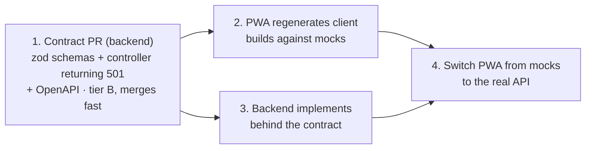

# Working together: two people, many agents, two repos

How the two of us build `figcit-backend` and `figcit-pwa` at full speed without waiting on each other or overwriting each other's work. We both run coding agents (Claude Code, OpenCode) and track work in GitHub issues (and a GitHub Project once our agents can reach it: section 12.1).

This file is **identical in both repos**. Change it in both in the same pull-request pair.

Agents: your operating instructions are in `AGENTS.md` at the repo root. This document is the reasoning behind them.

---

## 1. The six rules

1. **One issue = one branch = one worktree = one agent session = one pull request.** No agent works on two issues at once; no two agents share a branch.
2. **Claim before you code.** Set the issue to *In progress* (the `status:in-progress` label until the board works: section 12.1) before any code is written. That's the lock: if it's claimed, it's not yours.
3. **Stay in your lane.** Each person owns a set of modules in both repos (section 2). Touching the other lane's files needs a comment on their issue first, or a small separate PR they review.
4. **Contract first across repos.** When a feature spans both repos, the API contract merges first (in a few minutes), so the PWA never waits for the backend implementation (section 6).
5. **Small and often.** Branches live less than a day (two at most); pull requests aim for under 400 changed lines; auto-merge when checks pass.
6. **Generated and shared files are regenerated, never hand-merged** (section 3).

---

## 2. Lanes

Work is split by **vertical slice**: each person owns whole features end to end, backend module and PWA feature together, so most issues touch only one person's files. The module boundaries in `docs/SYSTEM_DESIGN.md` and the engineering rules keep slices apart. The split follows our strengths, though we're both generalists: **Lane A** leans full-stack and AI, **Lane B** leans backend and infrastructure.

| | **Lane A: app, core loop and AI** | **Lane B: platform, infrastructure and pathways** |
| --- | --- | --- |
| Owner | **Twilight-Techy** | **Abdurrahman Adenowo** (`OadeO6`) |
| Backend | `packages/engine`, `packages/rules-compiler`; modules Rules, Content, CheckIn, Recommendation, Safety, Feedback, AI, Speech, Dump, Express, Tasks, Reflect, Admin (rules, content, decision log, safety events) | Workspace and tooling, Docker, CI/CD, environments and hosting, database setup, backups, observability (logs, metrics, GlitchTip, uptime), AI server deployment (llama.cpp, whisper.cpp); modules Auth, Users, Consent, Audit, Sync, Notifications, Jobs, Files, Entitlements, Analytics, Health, Regulate, Adapt, Connect, Practices, Progress |
| PWA | `src/ds/` (design system), `src/lib/` except the Lane B folders, the root layout and Help pill; features `home`, `help`, `checkin`, `recommendation`, `safety`, `support-plan`, `feedback`, `dump`, `speech`, `express`, `tasks`, `reflect`, `admin` | `src/lib/db/` (Dexie), `src/lib/sync/` (outbox, sync), `src/lib/http/`, `src/lib/errors/`, `src/api/` (generated client), `src/mocks/`, `src/sw/`, PWA CI and hosting config (`vercel.json`, security headers); features `system`, `auth`, `onboarding`, `settings`, `notifications`, `reminders`, `install`, `plans`, `progress`, `share`, `regulate`, `adapt`, `connect`, `practices`, `institutions` |
| Why this split | The rules engine, safety, the main journey, the AI features and the UI foundations are one connected piece of product logic | Accounts, data, sync, scheduling, deployment and security are one connected piece of platform, plus the pathways that are mostly data and timers |

**Shared, owned by one lane, changed by both through small PRs:** the design system and root layout (Lane A), the engine's public types (Lane A), the Prisma base schema files `_shared.prisma` and `users.prisma` (Lane B), and `src/lib/db/` (Lane B).

**First sprint (S0), both working from day one:**

| | Lane A: Twilight-Techy | Lane B: Abdurrahman |
| --- | --- | --- |
| Backend | `packages/engine` skeleton, `rules-compiler` reading the workbook, first engine fixtures (Tabs 1 and 10), once Lane B's workspace has landed | First, on day one: pnpm workspace, TypeScript/ESLint/Prettier config, Docker and the local stack (Postgres, Mailpit, SeaweedFS), CI. Then Prisma multi-file setup, Auth, Users, Consent and Audit modules, refresh-token flow, OpenAPI generation |
| PWA | Next.js scaffold, design tokens and the six themes, comfort settings, root layout with the Help pill, Help/SOS page, check-in screens on mocked API | PWA CI, service worker, Dexie and outbox, generated API client, staging environment for both repos |

If the lanes feel uneven after a sprint, move a whole module, never half of one.

---

## 3. Files that cause conflicts, and the rules for them

Most conflicts come from a few shared files. Each has a rule that makes conflicts trivial or impossible.

### Backend
| File | Rule |
| --- | --- |
| Prisma schema | **One file per module** in `apps/api/prisma/schema/` (Prisma's multi-file schema): `checkin.prisma`, `tasks.prisma`, … Shared enums and `User` live in `_shared.prisma` and `users.prisma` (Lane B). You only edit your module's file. |
| Migrations | **One migration per PR.** Before merging: `git pull --rebase origin main`, delete your migration folder, regenerate it (`pnpm db:migration <name>`), run tests. Never edit a migration that's on `main`. If both of us have migrations ready, whoever merges second regenerates. |
| `app.module.ts` | Modules listed one per line, alphabetically. Conflicts are a one-line keep-both. |
| `openapi/openapi.json` (generated) | Never hand-merge: take either side, then `pnpm openapi:generate`. CI fails if it's stale. |
| `packages/engine/fixtures/*` (generated from the workbook) | Lane A only; regenerate with `pnpm fixtures:generate`. |
| `.env.example`, config schema | Append only, alphabetical within each section. |

### PWA
| File | Rule |
| --- | --- |
| Messages (copy) | **One file per feature**: `src/messages/en/<feature>.json`. You only edit your features' files. |
| Routes | Each feature's routes sit in their own folder under `src/app/`; the lane that owns the feature owns its folder. |
| `src/app/layout.tsx` | Lane A, tier A review (it holds the Help pill). |
| Design system (`src/ds/`) | Lane A. Need a new component or token? Open a small PR or an issue tagged `design-system`; don't add one-off styles in a feature. |
| `src/api/` (generated client) | Never hand-merge: take either side, then `pnpm api:generate`. |
| Dexie schema version | Tables are declared in each feature's `local.schema.ts`; `src/lib/db/` combines them. On a version-number conflict, take the higher number plus one, and rerun the migration tests. |

### Both repos
| File | Rule |
| --- | --- |
| `pnpm-lock.yaml` | Never hand-merge. `git checkout --theirs pnpm-lock.yaml && pnpm install`, then commit. Add dependencies in their own tiny PR when you can. |
| `package.json` | Keep-both on conflicts, then `pnpm install`. |
| Docs (`docs/*.md`) | Changes to `SYSTEM_DESIGN.md`, `ENGINEERING_RULES.md`, `CONFLICTS.md` or this file go in their own PR, reviewed by the other person. |

---

## 4. Branches, pull requests and merging

- **Trunk:** `main`, always deployable. Everything merges into `main` by squash merge.
- **Branch names:** `<initials>/<issue-number>-<short-slug>`, e.g. `ab/42-checkin-api`. Agents use the same pattern.
- **Stay current:** rebase on `main` at the start of every session and before opening the PR (`git pull --rebase origin main`).
- **Draft PRs early:** open a draft as soon as the first commit exists, so the other person (and their agent) can see what's moving.
- **Auto-merge:** turn it on when opening the PR. It merges itself when CI passes and any required review is in.
- **Branches don't have to be up to date before merging:** with only two of us, requiring it would make every merge wait on the other. Instead, CI runs again on `main` after every merge. **If `main` goes red, whoever broke it fixes or reverts it within 15 minutes**, and nobody merges until it's green.

### Review tiers

Review only where it matters, so most PRs never wait for a human:

| Tier | What | Review |
| --- | --- | --- |
| **A** | Safety, auth, encryption, consent, sharing, the engine and rules compiler, migrations, the PWA root layout and Help, offline sync, the service worker, CSP/security headers, CI and GitHub settings, the four docs in section 3 | **The other person approves.** Enforced by `CODEOWNERS` plus branch protection. Turnaround target: 4 working hours. |
| **B** | Everything else | CI green + the author's own check of the agent's work → auto-merge. The other person may comment afterwards; follow-ups go in new PRs. |

The author always reads the diff their agent produced before marking a PR ready. Agent output isn't reviewed by its own agent alone.

---

## 5. Running many agents in parallel

Each of us can run several agents at once, one per issue, as long as each has its own **git worktree**:

```bash
# one worktree per issue, created from the latest main
git fetch origin
git worktree add ../figcit-backend-42 -b ab/42-checkin-api origin/main
cd ../figcit-backend-42 && pnpm install
# start the agent here (claude / opencode), then: git worktree remove ../figcit-backend-42 when merged
```

Worktrees on one machine must not fight over local resources:
- **Database:** one shared local Postgres container, one database per worktree (`pnpm db:worktree` creates `figcit_<branch>` and writes it to the worktree's `.env`).
- **Ports:** `pnpm dev` picks a free port per worktree (API from 4000 upwards, PWA from 3000 upwards).
- **Caches:** pnpm's shared store means installs per worktree are fast and use little disk.

### What every agent session does
1. Read `AGENTS.md`, then the issue.
2. Check the issue is assigned to its person and *In progress* (section 12.1); check no other open PR touches the same module (see the issue's **Touches** field).
3. Work only within the files the issue says it touches. If the change needs more, say so in the issue and stop or narrow the change.
4. Run the checks (`pnpm check`: lint, types, tests, budgets) until green.
5. Open the PR with the template filled in, link the issue, set auto-merge (tier rules in section 12.4), move the issue to *In review*.
6. Stop. One issue per session.

### What agents never do
- Push to `main` or force-push someone else's branch.
- Merge any PR, tier-A included, unless Twilight-Techy or Abdurrahman (OadeO6) explicitly asks for that PR to be merged (section 11).
- Edit the other lane's files without that being in the issue.
- Hand-merge generated files (section 3).
- Change `SYSTEM_DESIGN.md`, `ENGINEERING_RULES.md`, `CONFLICTS.md` or this file unless the issue says so.
- Decide a product question. Open questions go to the issue as a comment, tagged `needs-decision`, and the agent moves on.
- Add a dependency without the justification required by the engineering rules.
- Put secrets, real user data or production URLs with tokens into prompts or code.

---

## 6. Features that span both repos: contract first



1. **Contract PR** in the backend: request/response zod schemas, the controller route returning `501 Not Implemented`, and the regenerated OpenAPI file. Usually under 100 lines, tier B, merged within minutes.
2. **PWA** runs `pnpm api:generate` and builds the screen against **MSW mocks** created from the OpenAPI examples. It doesn't wait for step 3.
3. **Backend** implements the behaviour in its own PR(s).
4. When the endpoint is live on staging, the PWA's mock for it is switched off.

**Contract changes after merge are additive only:** new optional fields or new endpoints. Removing or renaming anything means a new field or version, with the old one deprecated for one release.

**The engine package:** Lane A publishes `@figcit/engine` from the backend repo with semantic versions; the PWA updates through a normal PR. A breaking change in the engine's input/output types is a major version and needs a tier-A review in both repos.

---

## 7. The GitHub Project

One Project for both repos (owned by the `Twilight-Techy` account), managed by both of us and our agents through the GitHub MCP server.

**Fields**

| Field | Type | Values |
| --- | --- | --- |
| Status | Single select | Backlog · Ready · In progress · In review · Blocked · Done |
| Lane | Single select | A · B |
| Repo | Single select | backend · pwa · both |
| Area | Text | Module or feature name, e.g. `checkin`, `features/dump` |
| Touches | Text | The folders or files the issue will change |
| Sprint | Iteration | One-week iterations |
| Size | Single select | XS (< 1 h) · S (half a day) · M (1 day). Anything bigger is split. |
| Priority | Single select | P0 · P1 · P2 |
| PRD ref | Text | Story and child issue, e.g. `US-M02-01.3` |
| Tier | Single select | A · B |

**Views:** *Now* (everything In progress or In review, both people), *My lane* (board filtered by Lane), *Sprint* (table by Sprint and Priority), *Blocked*.

**Built-in workflows to turn on:** item added → Backlog; PR opened → In review; PR merged or issue closed → Done.

**Issues** come from the PRD's stories and child issues (section 10 of the PRD), split so each is at most one day of agent work, with acceptance criteria and **Touches** filled in (issue template `task`). An issue isn't *Ready* until both are present.

**MCP access:** the agents need the GitHub MCP server with the **projects** toolset enabled to read and update the board. The tools in this Claude Code cloud session don't include Projects, so the board is created and managed from your own machines' MCP setup.

---

## 8. Staying in sync without meetings

- **The issues are the status** (the board, once it works). No daily stand-up needed; check what's *In progress* and *In review* before starting a session.
- **Blocked?** Mark it *Blocked* (section 12.1), link the blocking issue in a comment, mention the other person, then pick up a different issue.
- **Product questions** go in the issue (`needs-decision`); decisions get recorded in `docs/CONFLICTS.md` or an ADR, never only in chat.
- **Weekly, 15 minutes:** plan the next sprint, rebalance lanes if needed, look at anything *Blocked* for more than a day.

---

## 9. Environments and secrets

- Each of us has a local stack (Docker Postgres, Mailpit, SeaweedFS) and optionally our own Neon development branch. We never share a development database.
- **Staging deploys only from `main`.** Production only from release tags, approved by both of us.
- Secrets are encrypted in the repo with **SOPS + age**; each of us has our own age key, and both keys can decrypt. Never paste secrets into chats, issues, PRs or agent prompts. `.env.example` lists every variable without values.

---

## 10. One-time setup

1. Create `main` from the current work and make it the default branch in both repos.
2. Add the second developer (`OadeO6`) as a collaborator to both repos (done once the invite is accepted); `.github/CODEOWNERS` already lists both of us.
3. Branch protection on `main` in both repos:
   - require a pull request;
   - require status checks (CI);
   - require review from code owners;
   - required approvals: **0**, so only tier-A paths need a review;
   - block force-pushes and deletion.
4. Repo settings: allow squash merge only; allow auto-merge; delete branches after merge.
5. Create the GitHub Project with the fields and views in section 7, and turn on its built-in workflows.
6. Create labels: `lane-a`, `lane-b`, `tier-a`, `needs-decision`, `blocked`, `design-system`, `contract`, `status:in-progress`, `status:in-review`, plus `sprint:S0`–`sprint:S13`, `size:xs|s|m` and `p0|p1|p2` (most already exist from the backlog).
7. Each of us: enable the GitHub MCP **projects** toolset in our agent setup (Claude Code and OpenCode), and generate an age key for SOPS.
8. Each of us: set git identity to our own GitHub email, and give our agents our own GitHub access (section 11).

---

## 11. Accounts and identity

We share one Claude account but each have our own GitHub account. GitHub attributes every action to the account that performed it, so the rules below keep authorship and review honest.

| Action | Recorded as | Rule |
| --- | --- | --- |
| Commits | The author in the local git config | Set `git config --global user.name` and `user.email` to the email on **your own** GitHub account. Agents never change git identity. |
| Pushes | Whoever's git credentials push | Push with your own SSH key or token. |
| PRs, comments, reviews, labels, Project updates | The GitHub account the agent's GitHub tool is signed in to | Each person's agents use **their own** GitHub access: Twilight-Techy through the claude.ai GitHub connector; Abdurrahman through a GitHub MCP server or `gh` CLI with his own token in Claude Code and OpenCode. Abdurrahman's sessions don't use the claude.ai connector for anything that writes to GitHub. |

**Rules for every agent session:**
1. **Check identity before writing to GitHub.** Call the GitHub tool's "who am I" (`get_me`, or `gh api user`). If the login isn't the person running the session, stop and ask; don't open PRs, comment or update the board.
2. **Agents never approve PRs, and merge only when asked.** Approval is a human decision: the reviewer approves in the GitHub UI, or explicitly tells their own agent to approve after reading the diff. An agent never approves a PR in the same session that wrote it. An agent merges a PR only when Twilight-Techy or Abdurrahman explicitly asks it to merge that PR; the request is the human decision, so the agent doesn't wait for an approval the person has chosen to skip.
3. **The PR author is the person whose agent did the work.** This matters for tier-A reviews: GitHub doesn't let anyone approve their own PR, so a PR opened under the wrong account blocks the review.

**Shared Claude usage:** one account means one set of usage limits. When both of us run many agents at once, stagger the heavy sessions (large refactors, long test runs) and keep sessions to one issue each.

---

## 12. Issues and pull requests

### 12.1 Status without the Project board
Until the GitHub Project works through our agents' MCP tools (section 7), **the assignee and labels are the status**. Once the board works, its Status field replaces the `status:` labels; don't keep both.

| Status | How it shows on the issue |
| --- | --- |
| Backlog | Open, no status label, and at least one issue under **Depends on** is still open |
| Ready | Open, no status label, and everything under **Depends on** is closed (or, for an API dependency, its contract PR has merged: section 6) |
| In progress | Assigned to the person working on it, label `status:in-progress` |
| In review | Label `status:in-review`; the PR is open and linked |
| Blocked | Label `blocked`, plus a comment naming the blocker (issue, PR or decision) and mentioning the person who can unblock it |
| Done | Closed by the merged PR |

Swap the label when the status changes; an issue has at most one `status:` label.

### 12.2 Picking and claiming an issue
1. **Pick from your own lane:** issues assigned to you. To take one from the other lane, ask on the issue and wait for its owner to reassign it.
2. **In this order:** earliest sprint first, then priority (P0 → P2), then lowest number. Skip anything that isn't *Ready*.
3. **Check for overlap:** no open PR may touch the same folders as the issue's **Touches**. If one does, pick another issue.
4. **Claim it:** add `status:in-progress` before writing any code. That label is the lock.
5. **Limits:** one issue per agent session, and at most three issues *In progress* per person. Finish or hand back before claiming a fourth.
6. **Going quiet:** an issue *In progress* with no pushed commit for two working days gets a comment saying why, or the label comes off so someone else can take it.

### 12.3 Writing and changing issues
- **Format:** new issues use the `task` template. The first line holds PRD ref, lane, tier, sprint, size and priority; then **Goal**, **Acceptance criteria** (checkboxes), **Touches**, **Depends on** and **Notes**.
- **Labels:** one each of `lane-a`/`lane-b`, `sprint:Sx`, `size:xs|s|m` and `p0|p1|p2`. Add `tier-a` when **Touches** includes a tier-A path, `contract` for an API contract, and `needs-decision` when the issue rests on an open CONFLICTS item. Assign the issue to its lane's owner.
- **References:** a reference to the other repo is always written in full (`Twilight-Techy/figcit-backend#42`). A bare `#42` points at the current repo.
- **Too big:** an issue bigger than M is split before work starts. Open the parts as new issues, link them from the original, and close the original as *not planned* with a comment listing the parts.
- **Follow-up issues:** agents may open one for:
  - a bug found outside the issue's **Touches**;
  - work cut from a PR's scope;
  - the issue link a `TODO` needs (ENGINEERING_RULES §14).

  The follow-up gets the same template and labels, goes to its lane's owner, and is linked from the PR. Product questions are not follow-up issues: they're a `needs-decision` comment on the existing issue.
- **Changing an issue:**
  - **Ticking criteria:** the author ticks acceptance criteria as they're met.
  - **Adding or removing criteria:** needs a comment saying why.
  - **The other lane's issues:** comment rather than edit.
- **Closing:**
  - **Normal:** issues close through a merged PR (`Closes #N`).
  - **Already done elsewhere:** close as *completed* with a link to where it was done.
  - **Dropped:** close as *not planned* with the reason.
  - **Who closes:** only the issue's owner closes it by hand.

### 12.4 Pull requests
- **One PR per issue**, with two exceptions, both of which link the issue with `Part of #N` until the last PR uses `Closes #N`:
  - the contract PR and the implementation PR for an API (section 6);
  - a change over 400 lines, split into a short stack of PRs.
- **Title:** a conventional commit (`feat(checkin): store emotions with intensity`). A squash merge uses it as the commit message on `main`.
- **Body:** the PR template, filled in. Name any CONFLICTS item and the recommendation used. Add the issue's lane label to the PR, and `tier-a` or `contract` where they apply.
- **Draft, then ready:**
  - **Opening:** open a draft early (section 4).
  - **Ready:** mark it ready only when `pnpm check` passes and the author has read the whole diff.
  - **Label swap:** at the same time, move the issue from `status:in-progress` to `status:in-review`.
- **Which tier, when the signals disagree:** the stricter one wins.
  - **PR touches a CODEOWNERS path but the issue lacks `tier-a`:** branch protection already requires the review. Add the label to the issue.
  - **Issue is `tier-a` but the PR touches no CODEOWNERS path:** nothing enforces the review. Request the other person's review and turn auto-merge on only after they approve.
- **Review comments:**
  - **Who fixes them:** the author's agent, in a new session in the same worktree and on the same branch.
  - **Replying:** reply on each thread with what changed, or why nothing did. Resolve the threads you fixed.
  - **Changes requested:** re-request the reviewer's review.
  - **Turnaround:** the reviewer aims to respond within 4 working hours for tier A (section 4).
- **History:** before review starts, rebase and force-push your own branch freely. Once the PR is marked ready, bring `main` in with `git merge origin/main` instead, so review threads stay attached. The squash merge tidies it up.
- **Stale PRs:**
  - **Quiet ready PR:** one with no activity for one working day gets a status comment from its author.
  - **Old draft:** one older than two working days is split or closed.
- **Merging:**
  - **How:** through auto-merge, or by an agent when one of us explicitly asks it to merge that PR. Agents never approve (section 11).
  - **When:** a tier-A PR merges itself once the other person approves.
  - **Afterwards:** the issue closes, its `status:` label comes off, and the author removes the worktree.
- **Reverting:** a revert PR links the original PR and reopens its issue with a comment saying what broke.
