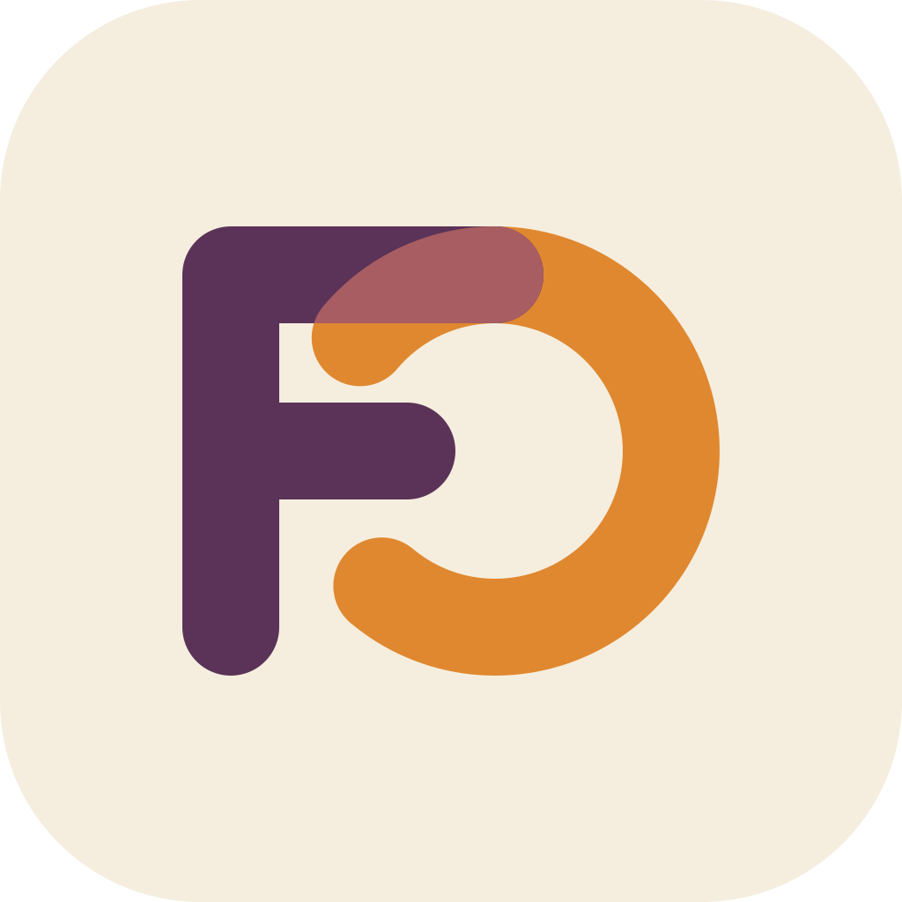

**FIGCIT**

*Fix the fit, thrive as you are.*

**NUCCESS Privacy Notice**

How we use and protect your information

For people who use the NUCCESS app

Figcit Ltd · admin@figcit.co.uk · www.figcit.co.uk

Version 0.1 (draft) · September 2026

*Draft for review by a solicitor and a data protection specialist before publication. Items in \[square brackets\] need a decision or confirmation. Last updated: \[date\].*

## At a glance

| **Question**                                                  | **Short answer**                                                                                                                                     |
|---------------------------------------------------------------|------------------------------------------------------------------------------------------------------------------------------------------------------|
| **Who looks after my data?**                                  | Figcit Ltd, the company that makes NUCCESS.                                                                                                          |
| **What do you collect?**                                      | Your account details, your check-ins (energy, mood, feelings, body sensations, where you are), the tasks and notes you add, and how you use the app. |
| **Why?**                                                      | To suggest support that fits how you are right now, to keep you safe, and to improve NUCCESS.                                                        |
| **Is any of it sensitive?**                                   | Yes. Check-ins can be health information, so we only use them with your explicit consent — and you can withdraw it at any time.                      |
| **Do you sell my data?**                                      | No. Never.                                                                                                                                           |
| **Does my university, college or employer see my check-ins?** | No. If they provide NUCCESS, they only see anonymised trends for groups of five or more people.                                                      |
| **Is NUCCESS an emergency service?**                          | No. If you are in danger, call 999. You can call Samaritans free on 116 123, any time.                                                               |
| **Can I see, download or delete my data?**                    | Yes — in Settings, or by emailing us.                                                                                                                |

This notice is also available in easy read and audio. Ask us at admin@figcit.co.uk.

## 1. Who we are

NUCCESS is provided by Figcit Ltd, a company registered in England and Wales (company number \[ \]), registered office \[ \]. For the NUCCESS app, Figcit is the **controller** of your personal data — we decide how and why it is used. Our Data Protection Lead is \[name\], contactable at \[email\]. Figcit is registered with the Information Commissioner's Office (ICO) (registration number \[ \]).

**If you use NUCCESS through your university, college or employer,** that organisation has a contract with us. \[Confirm per contract: Figcit remains the controller of your personal check-ins; the organisation receives only anonymised, grouped information.\] Your organisation may have its own privacy notice about the dashboard it sees.

## 2. What information we collect

| **Type**               | **Examples**                                                                                                                                                    | **Where it comes from**                                |
|------------------------|-----------------------------------------------------------------------------------------------------------------------------------------------------------------|--------------------------------------------------------|
| **Account details**    | Name or nickname, email, password (encrypted), confirmation that you're 18 or over, your subscription. A guest space has none of the email, password or subscription | You                                                    |
| **Check-ins**          | Energy and mood, emotions and their intensity, optional body sensations (including pain and things like hunger or tiredness), where you are and who you're with | You                                                    |
| **Tasks and notes**    | Tasks, deadlines, brain dumps, drafts you write in Express, reflections                                                                                         | You                                                    |
| **Preferences**        | Interests, sensory settings, reminder times, trusted contact (if you add one)                                                                                   | You                                                    |
| **Safety information** | A record that the support screen was shown and which option you chose                                                                                           | The app                                                |
| **Usage and device**   | Features used, time of use, app version, device type, crash reports                                                                                             | The app (analytics only with your consent)             |
| **Payments**           | Subscription status; we don't see your card details                                                                                                             | Apple App Store or Google Play \[or payment provider\] |
| **Messages to us**     | Support requests, feedback, complaints                                                                                                                          | You                                                    |

We never ask you for a diagnosis. You don't have to tell us about any condition to use NUCCESS.

## 3. How we use it, and our lawful basis

| **What we do**                                                                                          | **Lawful basis (UK GDPR)**                                                                                                                              |
|---------------------------------------------------------------------------------------------------------|---------------------------------------------------------------------------------------------------------------------------------------------------------|
| **Provide your account and the app's features**                                                         | Contract — to provide the service you signed up for                                                                                                     |
| **Use your check-ins (health information) to suggest support and tasks**                                | Your explicit consent (Article 9(2)(a)), given when you set up NUCCESS. You can withdraw it in Settings; the app's personalised features will then stop |
| **Show the support screen if you choose a crisis option or type words that suggest you may be at risk** | Your explicit consent, and where necessary to protect someone's vital interests                                                                         |
| **Keep the app safe and secure, prevent misuse and fix problems**                                       | Legitimate interests — keeping the service safe and working                                                                                             |
| **Improve NUCCESS using anonymised or aggregated information**                                          | Legitimate interests; we remove identifying details first                                                                                               |
| **Optional analytics**                                                                                  | Your consent — you can switch it off in Settings                                                                                                        |
| **Send you news or offers**                                                                             | Your consent only — unsubscribe at any time                                                                                                             |
| **Handle payments, tax and legal duties**                                                               | Contract and legal obligation                                                                                                                           |

## 4. How NUCCESS makes suggestions

NUCCESS uses a rules-based system designed by Figcit. Your energy and mood place you in one of 16 states on the Capacity Matrix, shown as a traffic light. Your feelings, sensations and setting shape the suggestion and can lower the light for safety. If you add a task, the app considers the kind of task and its deadline. This is a form of profiling, but it does not make decisions with legal or similarly significant effects on you — every suggestion is optional, and you choose what to do.

**AI features.** Some features use artificial intelligence to help — for example, sorting a task you type, breaking it into steps, or wording a suggestion. The AI works within fixed limits: it never decides your traffic light, never decides safety responses, and never gives counselling. When it's unsure, it asks you to confirm. Text sent to our AI provider is processed only to provide the feature; \[we do not allow our AI providers to use your data to train their models — confirm in supplier contract\].

## 5. Who we share information with

- **Service providers** who help us run NUCCESS — hosting, security, customer support, analytics (if you consent) and AI features. They act only on our instructions under contracts that protect your data.

- **App stores and payment providers,** to manage your subscription.

- **Your organisation** (if it provides NUCCESS): anonymised, grouped trends only, for groups of five or more. Never your individual check-ins, lights, notes or tasks.

- **Your trusted contact:** only if you choose to send them a message from the app.

- **Emergency services or safeguarding authorities:** only where the law allows or requires it to protect you or someone else from serious harm. We do not monitor check-ins in real time.

- **Professional advisers, regulators, courts or police,** where the law requires.

- **A buyer or investor** if Figcit's business is sold or restructured, under the same protections.

We never sell your personal data or use it for third-party advertising.

## 6. Where your data is stored

Your data is stored in \[the UK / the European Economic Area\]. If a provider processes data outside the UK, we use the protections UK law requires, such as the UK International Data Transfer Agreement or the UK Addendum to the EU Standard Contractual Clauses, or a UK adequacy decision.

## 7. How long we keep it

| **Information**                         | **How long**                                                                                                                   |
|-----------------------------------------|--------------------------------------------------------------------------------------------------------------------------------|
| **Account, check-ins, tasks and notes** | While your account is open. When you delete your account, we delete it within \[30\] days, and from backups within \[90\] days |
| **A guest space** (no email)            | 30 days from when it was made, and not extended. Then we delete it. If you create an account first, it becomes your account and the account row applies. Deleting a guest space deletes it at once. From backups the same \[90\] days apply |
| **Safety records**                      | \[Period to be set on legal advice\], then deleted                                                                             |
| **Guest sign-up limit**                 | A keyed hash of the network address that made a guest space, 2 days, to stop misuse. It cannot be turned back into the address |
| **Payment and tax records**             | 6 years, as the law requires                                                                                                   |
| **Support and complaint records**       | \[3\] years                                                                                                                    |
| **Anonymised, aggregated information**  | May be kept, because it no longer identifies you                                                                               |

## 8. Your rights

| **Right**               | **What it means**                                                                                             |
|-------------------------|---------------------------------------------------------------------------------------------------------------|
| **To be informed**      | This notice                                                                                                   |
| **Access**              | Get a copy of your data (Settings → Download my data, or email us)                                            |
| **Rectification**       | Correct anything wrong                                                                                        |
| **Erasure**             | Delete your account and data (Settings → Delete account)                                                      |
| **Restriction**         | Ask us to pause using your data in some circumstances                                                         |
| **Portability**         | Receive your data in a common format to take elsewhere                                                        |
| **Object**              | Object to uses based on legitimate interests, and to marketing at any time                                    |
| **Withdraw consent**    | Switch off personalised features, analytics or marketing in Settings, any time                                |
| **Automated decisions** | Ask about how suggestions are made; NUCCESS does not make solely automated decisions with significant effects |

Contact us at \[email\] in any format. We reply within one month (up to two further months for complex requests — we'll tell you if so). It's free in most cases.

## 9. Keeping your data safe

We use encryption, secure hosting, access controls and multi-factor authentication for our team, and we test our security regularly. Only people who need to see your data can do so. If a data breach is likely to put you at high risk, we will tell you promptly.

## 10. Age

NUCCESS is for people aged 18 and over. \[People aged 16–17 may use it only through a participating institution, under a separate notice and safeguarding arrangements.\] If we learn that someone under the age limit has an account, we will close it and delete their data.

## 11. Safety and crisis support

<table>
<colgroup>
<col style="width: 100%" />
</colgroup>
<tbody>
<tr class="odd">
<td>
<strong>NUCCESS is not an emergency service</strong>

If you are in immediate danger, call 999.

Samaritans: call 116 123, free, any time.

Shout: text SHOUT to 85258, free, any time.

NHS 111 for urgent health advice.
</td>
</tr>
</tbody>
</table>

## 12. Complaints

Please contact us first at \[email\] so we can put things right (see our Complaints Procedure). You also have the right to complain to the Information Commissioner's Office: ico.org.uk, 0303 123 1113.

## 13. Changes to this notice

We'll tell you in the app before any important change takes effect, and ask for your consent again where the law requires it.
